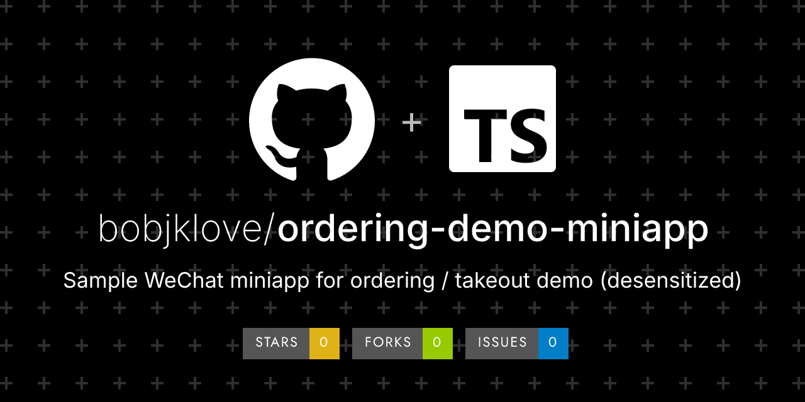

# ordering-demo-miniapp

Fictional shop: order → mock pay → admin inbox. 虚构店：下单→模拟支付→后台接单。

> **Sample / 样品** — not a production deliverable.  
> Fictional data only. No real merchants, payments, or customer PII.  
> 虚构数据；不含真实商户、真实支付或个人隐私。

## Demo

- Screenshots: _(add after first cut)_
- Live / video: _(optional; no real accounts)_

## What this is (and isn't)

| This sample **is** | This sample **is not** |
|---|---|
| A runnable slice you can clone and try | A finished product for a real business |
| Fictional shop / demo data | Real merchants, orders, or user PII |
| MIT/Apache licensed for learning & forking | A substitute for a scoped custom build |

## Quick start

```bash
git clone https://github.com/bobjklove/ordering-demo-miniapp.git
cd ordering-demo-miniapp
# Node.js 20+
npm install
npm test
npm run demo
# Customer H5: http://127.0.0.1:4173/
# Admin:       http://127.0.0.1:4173/admin/
# Demo login (shown on the login card): demo / nanfeng
```

Hot reload (separate origins — order state is **not** shared across ports):

```bash
npm run dev:h5      # http://127.0.0.1:5173/
npm run dev:admin   # http://127.0.0.1:5174/admin/
```

WeChat mini program preview (tourist AppID placeholder only):

```bash
npm run build:mp-weixin
# Import apps/customer/dist/build/mp-weixin in WeChat DevTools
```

## Scope

| In sample | Not in sample (typical custom add-ons) |
|---|---|
| Fictional menu · mock pay · points/coupons/wallet demo · H5 + WeChat mini program build · static merchant admin · bilingual UI | Real WeChat Pay · kitchen printer · multi-store · real AppID / merchant account · production hosting · branding |

## Stack

uni-app (Vue 3) customer H5 / WeChat mini program · Vite + Vue 3 static admin · localStorage + BroadcastChannel demo state · TypeScript · Vitest

## Custom work / 定制

Need the same idea for a **real** business (pay, printer, multi-store, your schema, App Store build, …)?

- Email: **ddxxdtt@gmail.com** (Bob Wei)
- Or open a GitHub Issue with the **custom-inquiry** template: https://github.com/bobjklove/ordering-demo-miniapp/issues/new?template=custom-inquiry.yml

Samples are free to fork under the license below.  
**Custom delivery is a separate contract, scoped and quoted — no fixed price on this page.**  
样品可 fork；**定制另签合同、按范围报价；本页不挂固定价。**

Need this for a real shop (pay / printer / multi-store)? Email us — sample is free to fork; custom build is scoped separately.

## License

MIT License — see [`LICENSE`](./LICENSE).

Open-source license ≠ custom delivery.  
开源许可 ≠ 定制交付；定制源码交付节点以合同为准。
